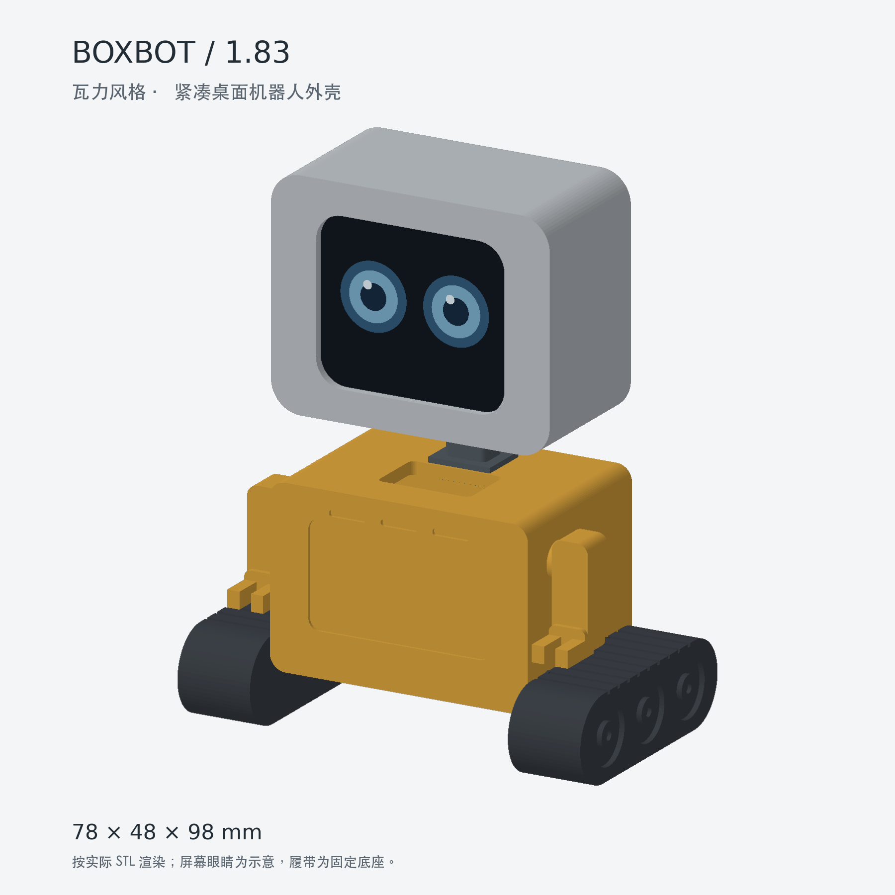
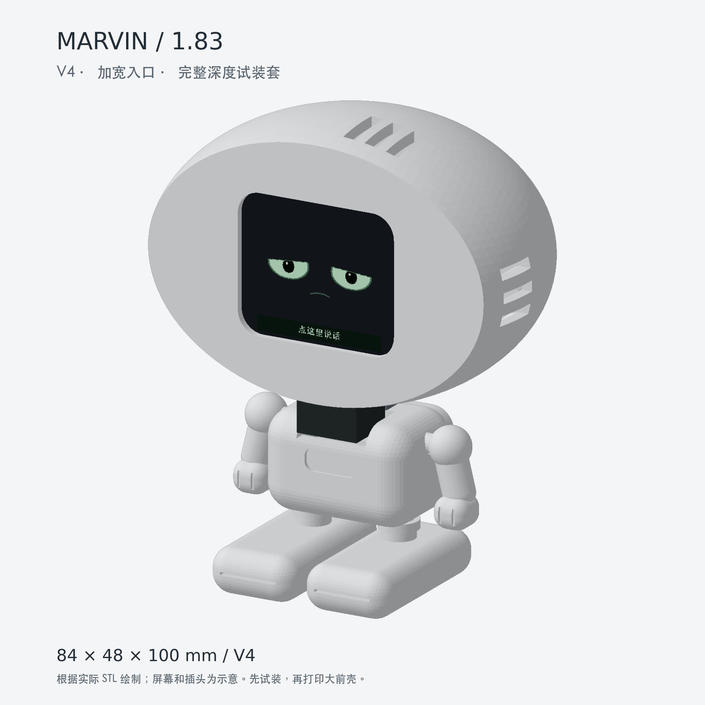

# ESP32 Desktop Robot · 桌面小机器人

基于 **微雪 ESP32-S3-Touch-LCD-1.83（16 MB Flash / 8 MB PSRAM）** 的桌面机器人：可打印外壳、会动的眼睛、触摸互动、摇晃转圈眼、抽签和 AI 语音对话。

两款外观分别受 WALL-E 和 Marvin 启发，是非官方爱好者项目。使用 Codex 协助编程、建模与文档整理。**项目没有获得原角色的形象或商标授权。**

| WALL-E 风格 | Marvin V4 |
| --- | --- |
|  |  |
| 约 78 × 48 × 98 mm，固定履带、可手动转向的头部 | 约 84 × 48 × 100 mm，大头、静态身体与四肢 |

图片为实际模型网格的渲染，屏幕画面为示意；不是打印成品照片。机器人暂时没有电机、行走或自动转头功能。

## 从哪里开始

1. **打印 WALL-E：**打开 [模型与装配说明](models/walle/README.md)，下载 `stl/` 分件，保持毫米单位、100% 比例。
2. **打印 Marvin：**使用 [Marvin V4 一次代打说明](models/marvin-v4/README.md)；正式件、备用垫片和备用脖子一起打齐。`一次打印排版_180mm.3mf` 包含 20 个打印实例，仍需按打印机设置支撑和切片。
3. **编译程序：**见 [固件安装与使用](firmware/README.md)，可选择 `walle-183` 或 `marvin-183`。
4. **只想下载：**进入 [Releases](https://github.com/samaritan1998/esp32-desktop-robot/releases)，模型包里有源码、参数、打印文件和许可证。

外壳均以**保留微雪原装黑壳**为设计前提，屏幕横装，USB、PWR 和 BOOT 所在一边朝下。不需要再加一块 ESP32 主板。裸屏、其他型号和大号 USB 插头需自行调整。

## 有什么互动

| 操作 | 行为 |
| --- | --- |
| 待机 | 眼睛移动、眨眼、不同情绪 |
| 轻点眼睛区域 | 开心、好奇等表情 |
| 轻晃 | 转圈眼 |
| 长按屏幕约 2 秒 | 抽签；双击退出 |
| 点底部说话区，或按 BOOT | 开始／结束语音对话 |

界面预览：[Marvin 的 16 种状态](docs/images/marvin-183.png) · [WALL-E 的 16 种状态](docs/images/walle-183.png)。

AI 对话需要 2.4 GHz Wi-Fi，并使用自行配置或绑定的兼容小智服务。本项目包含端侧适配，**不包含 AI 服务、账号、密钥或离线大模型**。默认不启用唤醒词。聊天时再次点击说话区可能打断回答；说完后先停下来等它播放。

## 验证到哪一步

| 部分 | 状态 |
| --- | --- |
| 两款外壳分件 | 已检查网格封闭性、连通性、打印底面和模型干涉 |
| WALL-E 实物 | 首位制作者反馈屏幕可以装入，未覆盖其他打印机与全部声孔、接口 |
| Marvin V4 实物 | **尚未实物确认**；通道已扩大，并与可装入的 WALL-E 参考空间做数字比对 |
| 表情、触摸、动作、抽签、联网语音 | 前期设备版本已由制作者确认可用 |
| 本次公开源码 | 中文字模改用 Noto Sans CJK SC；编译与渲染结果见 [验证记录](docs/validation.md)。本次字模更换后未重新刷入实机 |
| iPhone USB 音箱／小宇宙播客 | 未完成，不在本次发布范围 |

几何检查不能代替实物装配。找朋友代打时，最好将带黑壳的屏幕一起交付，在取件前完成干装；Marvin 包也备了可选厚度的垫片。不要强压玻璃、用螺丝拉合卡住的后盖，或整体缩放模型来修孔。

## 文件结构

```text
models/walle/              WALL-E 风格外壳、STL、参数化源码、装配说明
models/marvin-v4/          Marvin V4、备用件、3MF 排版、参数化源码
firmware/boards/           两个独立板型的端侧程序
firmware/core.patch        对固定版本小智上游的板型映射与诊断补丁
firmware/upstream.json     上游版本和校验值
tools/                    准备固件源码、生成字模、检查与预览
docs/                     硬件、验证记录、角色提示词
LICENSES/                 模型、上游软件和字体的许可全文
```

## 许可与来源

- **软件和 Python 建模工具：**[MIT](LICENSE)。来自小智的代码保留 [原 MIT 声明](LICENSES/xiaozhi-MIT.txt)。
- **模型设计文件与装配图文：**[CC BY-SA 4.0](LICENSES/CC-BY-SA-4.0.txt)，见 [模型授权范围](models/LICENSE.md)。署名可使用 `samaritan1998 / esp32-desktop-robot` 并链接本仓库；改作请注明修改。
- **`face_glyphs.h` 中文字模：**Noto Sans CJK SC 的位图子集，使用 [SIL OFL 1.1](LICENSES/OFL-1.1-NotoSansCJK.txt)，不受软件 MIT 许可覆盖。
- 其他依赖适用各自许可证，见 [第三方声明](THIRD_PARTY_NOTICES.md)。

许可只覆盖维护者有权许可的内容，不包括角色形象、名称相关商标、厂商商标或其他第三方权利。CC BY-SA 允许对获授权部分进行商业使用，但本项目不能授予角色 IP 的商业使用权。“非官方”声明本身不构成角色授权。

欢迎提交适配记录、装配照片和改进。报告装不进去时，请附板子／黑壳版本、最大外廓尺寸、打印材料、打印机、卡住位置及使用的模型版本；请勿上传设备 Flash 备份、密码、绑定码或对话日志。
