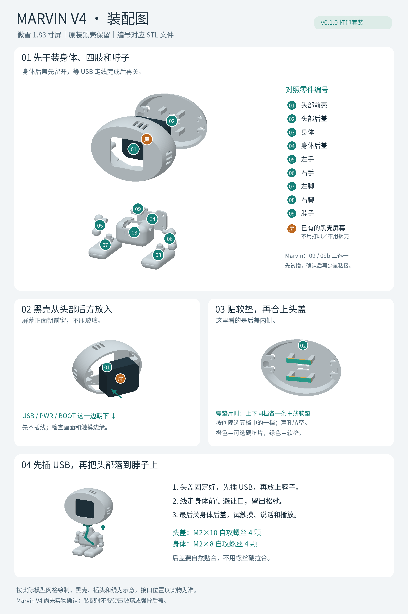

# Marvin V4 装配

可打开图片放大查看。圆圈里的编号对应打印文件编号，四个步骤依次完成；图中黑壳、插头和线为示意。

打印数量与模型说明见 [README.md](README.md)。整机 01—09 各一件；备用垫片五种厚度各两条；备用脖子 09b 一件。标准 09 与 09b 只选择其中一件安装。

另外准备：约 M2×10 mm 塑料自攻螺丝 4 颗固定头盖、约 M2×8 mm 螺丝 4 颗固定身体，以及薄软泡棉。模型底孔 1.7 mm、通孔 2.4 mm；实际螺丝长度、底孔和打印材料需要代打方试配，避免拧穿。

1. 按分件 STL 的原方向、毫米单位和 100% 比例切片。普通 PLA 可从 0.4 mm 喷嘴、0.16—0.20 mm 层高、3 道墙和 15—20% 填充开始；其他参数依机器设置。3MF 不包含支撑或机器配置。
2. 清理所有支撑、孔口毛边和首层外扩。先干装脚、手臂、脖子、身体后盖；插销紧时先清理，不要硬压。
3. 保留屏幕原装黑壳，横放，USB、PWR、BOOT 所在一边朝下。从 01 前头壳后方平直装入，玻璃朝前。前框支承原装壳边缘，不应挤压玻璃。
4. 检查有效画面、触摸边缘、底部说话区域、按键和 USB 插头都可用。01／02 必须同为 V4，不能与早期头盖混装。
5. 先试合 02 后盖。后盖内侧四个接触位置按实际间隙加薄软泡棉；若需要更厚支承，可选一档条垫，上下各一条，前面仍要有软垫。五档条垫只选合适的一档，不能全部叠装。不要堵声孔或以螺丝强拉合盖。
6. 头部还没安装到脖子上时，先接 USB，再把带线的头部放到脖子插销上。普通直插头的检查包络为 14 × 12 × 18 mm，更大的插头需另确认。软线从身体顶部前侧避让口引出，保持松弛，不要压线或大幅扭头。
7. 连接电源后检查站立、触摸、轻晃和语音录放。身体和四肢满意后再考虑少量胶固定；保留头盖的可拆卸性。

V4 尚未在制作者的实物上确认。若可以，将带黑壳屏幕交给代打方，让其取件前完成装板和合盖；一次代打包里的备用件用于现场调整，不构成一定装得进去的保证。
