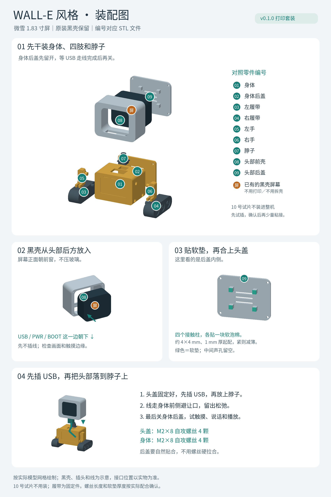

# BoxBot 1.83：瓦力风格桌面机器人外壳

这是一套受 WALL-E 启发、由参数化脚本生成的非官方外壳模型，适配带微雪原装黑色小壳的 ESP32-S3-Touch-LCD-1.83。整机外形为 **78 × 48 × 98 mm（宽 × 深 × 高）**，头部外壳宽 54 mm。保留屏幕的原装壳，横放安装，USB 和 PWR/BOOT 两个按键朝下。

履带是固定底座，两只小手是静态部件，头部使用插销可手动转向。这套文件包含外壳模型，屏幕动画需要另外烧录程序；预览图中的眼睛只展示显示效果。当前设计只安装 1.83 屏幕整机，另一块 N16R8-M 不在本版装配范围内。



圆圈里的编号对应 STL 文件。先装身体和四肢，黑壳从头部后方进入；贴好软垫并固定头盖后，先接 USB，再把头部装到脖子上。走线完成后再关身体后盖。

## 先做尺寸试装

1. 打印 `stl/10_fit_coupon.stl`，这是实际头部前框的前 6 mm。
2. 将黑壳整机横放、接口朝下，把屏幕正面从试片后方放入槽内。
3. 检查能否自然放入、屏幕活动画面是否完整露出、手指能否触摸。板子应停在前框内侧，塑料压在原装壳边框上，不压玻璃。
4. 确认后再打印完整头部。若卡住，测量整机外廓，调整参数后重生成；若只有打印造成的小毛边，去除毛边即可。

装板名义依据是微雪官方外形图：原装壳 **37.2 × 44.2 × 19.0 mm**，横放后为 **44.2 × 37.2 × 19.0 mm**。本模型的槽宽 44.8 mm、槽高 37.8 mm，每侧留 0.30 mm；前框窗口为 36.5 × 31.1 mm。角部形状根据官方外形图设置了宽松的圆角槽，仍需用试片确认实物。

官方依据：[产品尺寸](https://docs.waveshare.com/ESP32-S3-Touch-LCD-1.83#dimensions)、[结构资料](https://docs.waveshare.com/ESP32-S3-Touch-LCD-1.83/Resources-And-Documents)。

## 文件用途

| 文件 | 数量 | 用途 |
| --- | ---: | --- |
| `01_body_shell.stl` | 1 | 方形身体，后面开放，内部空腔 |
| `02_body_back.stl` | 1 | 身体后盖 |
| `03_track_left.stl` | 1 | 左履带底座，带定位插销 |
| `04_track_right.stl` | 1 | 右履带底座，带定位插销 |
| `05_arm_left.stl` | 1 | 左小手，带肩部插销 |
| `06_arm_right.stl` | 1 | 右小手，带肩部插销 |
| `07_neck.stl` | 1 | 脖子与手动转向插销 |
| `08_head_shell.stl` | 1 | 屏幕头部前壳，含下方接口开口 |
| `09_head_back.stl` | 1 | 头部后盖，内侧有软垫接触柱 |
| `10_fit_coupon.stl` | 1 | 先打印的装板尺寸试片 |

`stl/` 中的文件已按建议打印朝向放平在 Z=0，单位都是毫米，导入切片器后保持 **100% 比例**。`assembly_preview.stl` 是各部件的装配位置预览，不能直接用它替代分件打印；`assembly_preview.glb` 是带颜色的查看模型，里面还包含屏幕整机和眼睛示意。

## 打印设置

建议用普通 PLA、0.4 mm 喷嘴、0.16–0.20 mm 层高、3 道墙、4–5 层顶底和 15–20% 填充。先查看切片预览：细节和圆孔不应出现空层或孤岛。

- 身体、后盖、手臂和头部已经按大平面贴床、开口或插销朝上的方式摆放。
- 履带按正常落地朝向摆放，底部有平直的接触面。两枚横向定位插销可在切片器中添加局部支撑；不要给外侧轮纹塞满支撑。
- 头部颈座包含斜坡；若切片器仍判定颈座孔或接口开口需要支撑，只在这些局部添加。
- 建议颜色：身体与手臂用黄色，履带与脖子用深灰，头壳与头盖用银灰。可以全部用一种 PLA 打印后上色。
- 温度、速度与平台设置沿用打印机和耗材的 PLA 配置。材料用量、时间和价格以实际切片及代打报价为准。

## 另外准备

- 直径约 2 mm、长度 8 mm 的塑料自攻螺丝 **8 颗**，四颗用于头盖、四颗用于身体后盖。定位柱预留 1.7 mm 底孔，盖板通孔 2.4 mm。螺丝头需大于 2.4 mm 通孔；拧到盖板贴合即可。
- 约 **1 mm 厚的柔软泡棉胶带**，剪成四块 4 × 4 mm，贴在头部后盖的四个接触柱上。
- 一根能传数据的 USB-C 线。下方开口给常见小型插头和按键留了较大空间，但大号编织线插头仍需试装。
- 少量适用于 PLA 的胶水，可用于最终固定履带和手臂。先完成干装和电源测试再粘接。

## 装配顺序

1. 清理支撑和孔口毛边，确认所有插销能自然进入对应孔。
2. 将两侧履带的插销放入身体下方侧孔；把两只手装进上方侧孔。满意后可以用少量胶固定这四件。
3. 从身体顶部放入脖子的方形键，顶部挡边贴住身体顶面；根据需要用少量胶固定方形键。上面的圆形插销保留给头部转向。
4. 把原装屏幕整机横放，USB 和侧按键所在的一边朝下，从头壳后方放入。确认触摸窗口和下方接口均可用。
5. 在头盖内侧四根接触柱上贴泡棉胶带，再装四颗螺丝。名义模型中接触柱与原装壳背面留 0.8 mm，1 mm 软垫轻微压缩即可固定。若盖子需要用力才贴合，应减薄软垫或检查卡点。
6. 把头部下方孔放到脖子的圆形插销上。设计为间隙配合，松紧取决于打印公差；过松可在插销上贴一小条薄胶带，过紧先清理孔口。
7. USB 线从头部下方接入，向后引出。身体顶部留有 18 × 12 mm 走线开口，插头较长时可伸入开口，线缆可从身体内部经过后盖底部槽引出；也可在外侧走线。身体后盖可用另外四颗螺丝关闭。接好后测试供电、按键与触摸。

本版 USB 从头部下方接入，身体内的空间可用于走线和以后的小配件。带壳屏幕的麦克风与喇叭声学位置没有逐个开孔验证；本版优先满足表情与触摸，语音功能增加时需要再检查声孔。

## 修改源文件

`boxbot.scad` 可用 OpenSCAD 查看装配、爆炸图与各零件；修改文件顶部 `part` 切换零件，`explode` 调整分解距离。STL 由同一套布尔几何生成，OpenSCAD 源未在本机进行实际编译。

`build_model.py` 是生成模型的 Python 源文件。`parameters.json` 包含当前参数；主要可调整 `case_clearance`、`window_w/window_h`、插销与孔径，以及螺丝孔径。改变总外形、壳厚或安装位置时，应同步调整源码中对应的后盖、柱位和接口开口。

安装 Python 依赖后，在本文件夹中运行：

```sh
python3 -m pip install -r requirements.txt
python3 build_model.py --parameters parameters.json --out regenerated
```

结果在 `regenerated/`。改变屏幕厚度时还需同步调整后盖接触柱位置，不能只改 `case_d`。不建议在切片器里缩放整套模型，因为缩放也会改变装板槽与螺丝孔。

## 已完成的验证与实际限制

- 10 个 STL 均为单个连通、封闭、绕序一致的有效网格，体积为正，且打印摆放最低点为 Z=0。
- 9 个装配件之间的 36 组两两检查未发现体积重叠；头壳与后盖也通过了原装屏幕壳名义包络的干涉检查。详见 `validation.json`。
- 预览图由输出的实际模型网格渲染，屏幕眼睛仅为示意。
- 首位制作者反馈这版外壳可以装入其带原装黑壳的屏幕；没有采集实物尺寸或确认所有接口、声孔和打印公差。其他设备和打印机仍需自行确认，不能保证通用适配。

模型创建日期：2026-10-13。公开整理：2026-10-24。

模型文件与本说明适用 CC BY-SA 4.0；Python 建模脚本适用 MIT。仅许可项目维护者有权许可的内容，不包含原角色的形象、商标或其他第三方权利。
